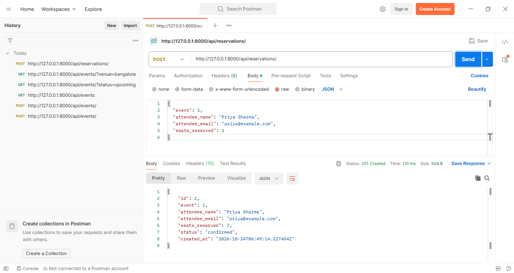
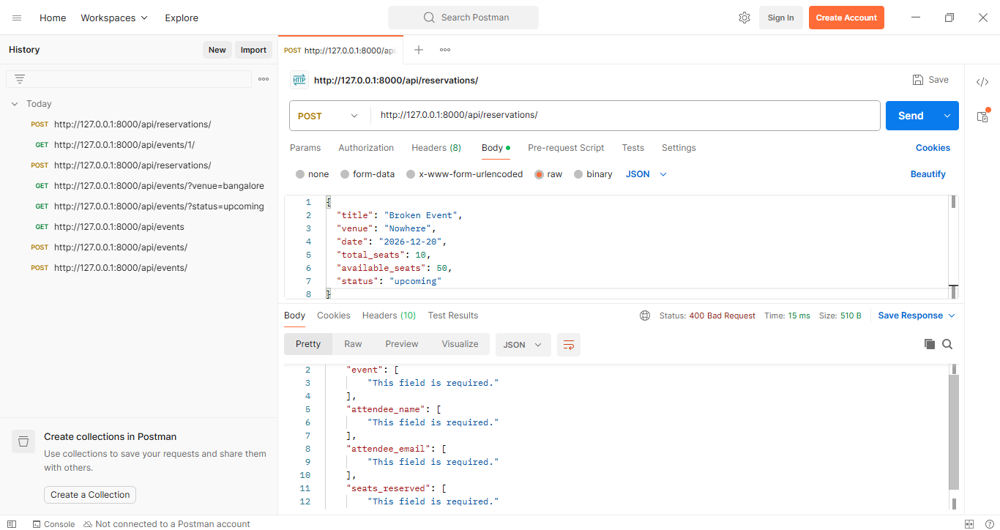
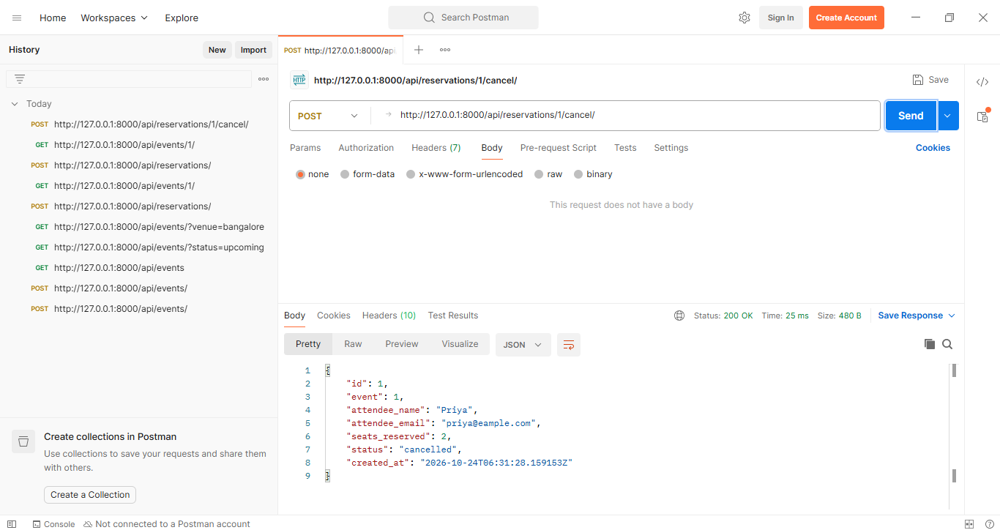
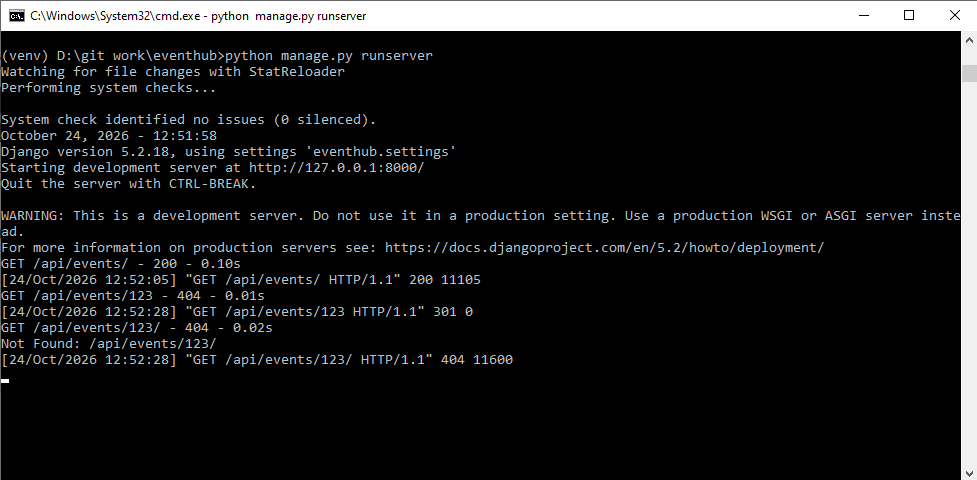

# EventHub

A backend API for a simplified event ticketing platform. Users can browse events, reserve seats, and cancel reservations. Built with Django, Django ORM, and Django REST Framework (serializers, ViewSets and a router).

## How to run

1. Clone the repo:
   ```
   git clone https://github.com/ankitamandowara/eventhub.git
   cd eventhub
   ```
2. Create and activate a virtual environment:
   ```
   python -m venv venv
   venv\Scripts\activate          (Windows)
   source venv/bin/activate       (Mac/Linux)
   ```
3. Install dependencies:
   ```
   python -m pip install -r requirements.txt
   ```
4. Create the database tables:
   ```
   python manage.py migrate
   ```
5. Start the server:
   ```
   python manage.py runserver
   ```
6. The API is now at `http://127.0.0.1:8000/api/`. Test it in Postman, or open the URL in a browser to use DRF's browsable API.

## Project structure

```
eventhub/
    manage.py
    requirements.txt
    screenshots/
    eventhub/
        settings.py
        urls.py
    events/
        models.py          # Event and Reservation models
        serializers.py     # validation and JSON conversion
        views.py           # ViewSets, filtering, cancel action
        urls.py            # router
        middleware.py      # request logging
        migrations/
```

## Endpoints

### Events

| Method | URL | What it does |
|---|---|---|
| GET | `/api/events/` | List all events |
| POST | `/api/events/` | Create an event |
| GET | `/api/events/{id}/` | Get one event |
| PUT / PATCH | `/api/events/{id}/` | Update an event |
| DELETE | `/api/events/{id}/` | Delete an event |
| GET | `/api/events/?status=upcoming` | Filter events by status |
| GET | `/api/events/?venue=bangalore` | Filter events by venue (partial, case-insensitive) |

Every event also shows `reservations_count`, the number of confirmed reservations.

### Reservations

| Method | URL | What it does |
|---|---|---|
| GET | `/api/reservations/` | List all reservations |
| POST | `/api/reservations/` | Reserve seats. Deducts the seats from the event |
| GET | `/api/reservations/{id}/` | Get one reservation |
| PUT / PATCH | `/api/reservations/{id}/` | Update a reservation |
| DELETE | `/api/reservations/{id}/` | Delete a reservation |
| GET | `/api/reservations/?event_id=1` | Filter reservations by event |
| POST | `/api/reservations/{id}/cancel/` | Cancel a reservation. Gives the seats back to the event |

### Validation rules

- An event's `available_seats` cannot exceed `total_seats`.
- A reservation needs at least 1 seat.
- Seats can only be reserved for `upcoming` or `ongoing` events.
- A reservation cannot ask for more seats than are available. This returns `400` with `Only X seat(s) available.`
- A reservation can only be cancelled once. A second cancel returns `400` with `Already cancelled.`

## Middleware

`RequestLoggingMiddleware` (in `events/middleware.py`) logs every request to the terminal in this format:

```
POST /api/reservations/ - 201 - 0.04s
```

## Design decision

I kept the seat deduction and the creation of the reservation together inside the serializer's `create()` method, as the brief describes. This keeps both changes in one place, so a reservation is never created without the seats being deducted. I know this approach has a weakness: if two people book the last seat at the same moment, both can pass the availability check before either one deducts, and the event could end up overbooked. In a production system I would wrap the check and the deduction in `transaction.atomic()` and lock the event row with `select_for_update()`, so the second request has to wait and then sees the updated seat count. I left that out here because the assignment keeps the scope simple, and SQLite with a single development server doesn't show the problem in practice.

## Known limitations

- Updating or deleting a reservation through `PUT`, `PATCH` or `DELETE` does not change the event's `available_seats`. Only creating and cancelling do. In a real system I would restrict those methods or handle the seats there too.
- No authentication, so anyone can create, cancel or delete anything.

## Postman screenshots

**Successful reservation (201 Created)**



**Overbooking attempt (400 Bad Request)**



**Successful cancellation (200 OK)**



**Request logging middleware output**

